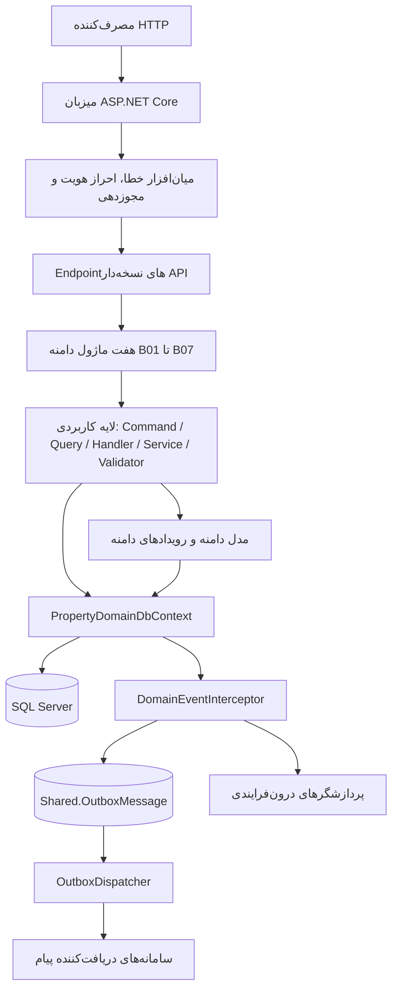
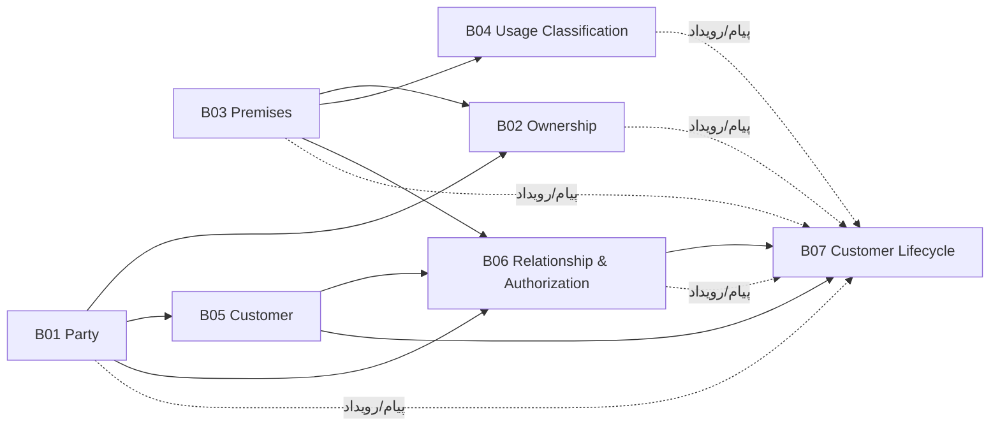
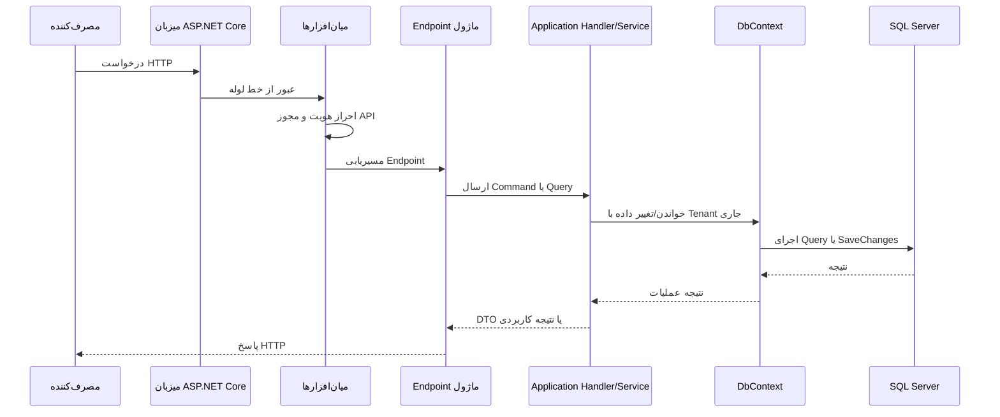
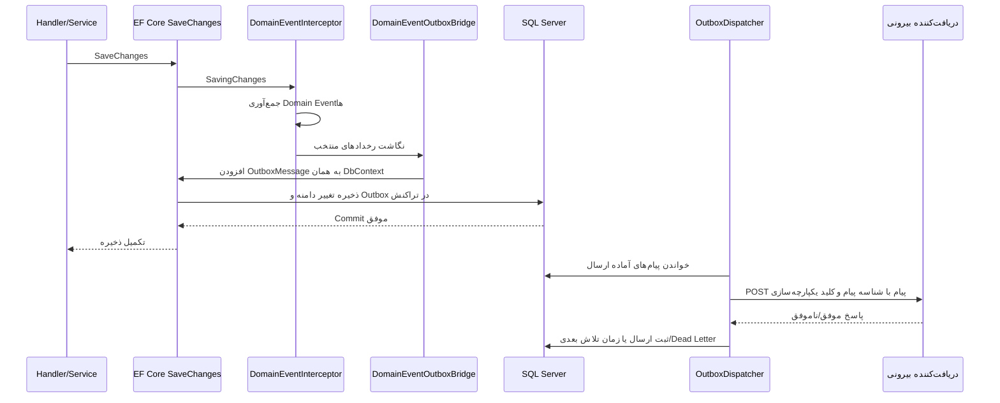

# معماری کلان سامانه PropertyDomain.WebApi

**نسخه مبنا:** Iteration 11.8 — Remaining Sprint Gap Closure  
**مرحله مستندسازی:** D02 — معماری کلان  
**وضعیت سند:** مستند توصیفیِ مبتنی بر کد موجود؛ نه پیشنهاد تغییر معماری  
**محدوده:** ساختار نرم‌افزار، مرز ماژول‌ها، لایه‌ها، جریان درخواست، داده، امنیت و یکپارچه‌سازی

---

## ۱. هدف و روش خواندن سند

این سند توضیح می‌دهد نسخه 11.8 سامانه چگونه سازمان‌دهی شده است. هدف، ثبت معماری قابل مشاهده در کد و قراردادهای موجود است؛ نه افزودن قابلیت جدید یا تعیین سیاست کسب‌وکاری که هنوز مرجع رسمی ندارد.

در این سند سه نوع گزاره از هم تفکیک می‌شوند:

- **وضعیت پیاده‌سازی‌شده:** مستقیماً در کد یا نگاشت پایگاه داده نسخه مبنا مشاهده می‌شود.
- **مرزبندی مفهومی:** برای توضیح مسئولیت ماژول‌ها و ارتباط آن‌ها استفاده می‌شود؛ الزاماً به معنی جدایی فیزیکی پروژه‌ها یا پایگاه‌های داده نیست.
- **نیازمند تکمیل/تصمیم:** کد یا اسناد موجود برای نتیجه‌گیری قطعی کافی نیستند؛ این موارد به‌عنوان قابلیت کامل‌شده معرفی نمی‌شوند.

### ۱.۱ منابع اصلی این سند

- `Program.cs`
- `PropertyDomain.WebApi.csproj`
- `Infrastructure/PropertyDomainDbContext.cs`
- `Application/Abstractions/ITenantContext.cs`
- `Infrastructure/HttpTenantContext.cs`
- `Infrastructure/DomainEvents/`
- `Infrastructure/Integration/`
- `Infrastructure/Observability/`
- پوشه‌های `Modules/B01..B07` و README هر ماژول
- `Docs/Integration/` و `Database/`

این سند صحت عملیاتی محیط استقرار، تنظیمات واقعی ارائه‌دهنده هویت، وضعیت اجرای SQL یا موفقیت آزمون‌های انتهابه‌انتها را اثبات نمی‌کند.

---

## ۲. نمای کلی معماری

### ۲.۱ سبک معماری مشاهده‌شده

سامانه در نسخه 11.8 یک **یکپارچه ماژولار (Modular Monolith)** است:

- یک پروژه اجرایی ASP.NET Core با نام `PropertyDomain.WebApi` دارد.
- هفت ماژول دامنه درون همان پروژه و در پوشه `Modules` سازمان‌دهی شده‌اند.
- همه ماژول‌ها از یک `PropertyDomainDbContext` و یک اتصال SQL Server استفاده می‌کنند.
- مدل Entityها در فضای نام مشترک `Domain.Entities` قرار گرفته است.
- Endpointها در سطح ماژول تعریف می‌شوند، اما در `Program.cs` به برنامه میزبان متصل می‌گردند.
- زیرساخت‌هایی مانند Tenant Context، مدیریت خطا، اعتبارسنجی، رویداد دامنه، Outbox و سنجه‌ها مشترک‌اند.

بنابراین «ماژول» در این نسخه مرز سازمان‌دهی و مسئولیت دامنه درون یک برنامه واحد است؛ نه یک سرویس مستقل، اسمبلی مستقل یا پایگاه داده مستقل.

### ۲.۲ نمودار سطح بالا

نمودار، مسیرهای اصلی کد را نشان می‌دهد. جزئیات همه مسیرهای HTTP یا همه Handlerها در این سطح نمایش داده نشده‌اند.

---

## ۳. مرز ماژول‌های دامنه

شناسه‌های B01 تا B07 برای نام‌گذاری دامنه و Schema پایگاه داده استفاده شده‌اند. این شناسه‌ها به‌تنهایی نشان‌دهنده ترتیب اجباری اجرای فرایندها نیستند.

| شناسه | ماژول | مسئولیت دامنه در نسخه جاری | مفاهیم و موجودیت‌های شاخص قابل مشاهده |
|---|---|---|---|
| B01 | `Party` | ثبت و نگهداری هویت اشخاص حقیقی و حقوقی، شناسه‌ها، اطلاعات تماس، احراز هویت و ادغام شخص | `Party`، `PartyIndividual`، `PartyOrganization`، `PartyIdentifier`، `PartyContact`، `IdentityVerification`، `PartyMerge` |
| B02 | `Ownership` | ثبت پرونده مالکیت برای موضوع ملکی، نسخه‌های وضعیت مالکیت، سهم اشخاص، رویداد و مستندات مالکیت، حق و سابقه تصرف | `OwnershipRegister`، `OwnershipStateVersion`، `OwnershipInterest`، `OwnershipEvent`، `OccupancyRight`، `OccupancyRecord` |
| B03 | `Premises` | نگهداری هویت پایدار Premises، نشانی‌ها، کاتالوگ اجزای ساختار ملک و پیوندهای زمانی ساختار | `Premises`، `PremisesAddress`، `Parcel`، `Building`، `Unit`، `PremisesParcelLink`، `PremisesBuildingLink`، `PremisesUnitLink` |
| B04 | `UsageClassification` | مدیریت طبقه‌بندی کاربری، بخش‌های کاربری، ادعاها، تخصیص‌های حقوقی/عملیاتی، فعالیت، پرونده تغییر و شواهد | `UsageClassification`، `UsageSegment`، `UsageAssertion`، `UsageAssignment`، `UsageActivity`، `UsageChangeCase`، `UsageEvidence` |
| B05 | `Customer` | ثبت مشترک، ارتباط مشترک با Party، نقش اصلی، طبقه‌بندی، محدودیت‌ها، تاریخچه وضعیت و ادغام مشترک | `Customer`، `CustomerPartyAssociation`، `CustomerStatusHistory`، `CustomerRestriction`، `CustomerMerge` |
| B06 | `Relationship` | تعریف نوع رابطه، ثبت رابطه Party با Premises یا Customer، تعریف نوع مجوز و ارزیابی مجوز در Scope مشخص | `Relationship`، `RelationshipType`، `Authorization`، `AuthorizationType`، `AuthorizationScope`، `RelationshipCase`، `RelationshipDispute` |
| B07 | `CustomerLifecycle` | مدیریت پرونده‌های چرخه عمر مشترک، درخواست تغییر اطلاعات، Timeline، بازسازی Projection و دریافت/پردازش پیام‌های یکپارچه | `CustomerLifecycleCase`، `CustomerInformationChangeRequest`، `CustomerTimelineEntry`، `CustomerTimelineRebuildRun` |

### ۳.۱ تمایز مفاهیم کلیدی

این مفاهیم در معماری یکسان یا قابل جایگزینی نیستند:

- `Party` نماینده شخص حقیقی یا حقوقی است؛ `Customer` رکورد نقش/رابطه مشترکی آن شخص با سامانه خدمات است.
- `Premises` هویت پایدار محل/ملک در دامنه است؛ `Parcel`، `Building` و `Unit` اجزای کاتالوگ ساختار فیزیکی‌اند.
- `Ownership` درباره مالکیت و منافع مالکانه است؛ `Occupancy` درباره حق یا سابقه تصرف/استفاده است. این دو نباید به یک رابطه واحد تقلیل داده شوند.
- `UsageSegment` بخش کاربری مستقل در محدوده Premises است؛ `UsageClassification` طبقه‌بندی قابل انتساب به آن است.
- `UsageAssertion` ادعا/مشاهده درباره کاربری است؛ `UsageAssignment` تخصیص ثبت‌شده کاربری است. وجود Assertion به‌تنهایی به معنی تخصیص معتبر نیست.
- `Relationship` رابطه تعریف‌شده میان Party و یک هدف از نوع Premises یا Customer است؛ `Authorization` مجوز انجام عملیات در Scope مشخص است.
- `CustomerTimelineEntry` نمای خواندنی/Projection است و نباید بدون بررسی منبع، جایگزین تاریخچه مرجع دامنه‌ای شود.

### ۳.۲ مرزهای آگاهانه و موارد تکمیل‌نشده

- در B03، مدل و APIهای کاتالوگ و پیوندهای زمانی ساختار ملک وجود دارند؛ گردش‌کار تأیید و اجرای `PropertyStructureChange` در README ماژول صریحاً تکمیل‌نشده اعلام شده است. همچنین وضعیت اجرای کامل زنجیره `ParcelBuilding` و `BuildingUnit` باید در مستندات جزئی B03 جداگانه بررسی شود؛ وجود جدول یا Entity به‌تنهایی اثبات‌کننده فعال بودن همه عملیات آن نیست.
- در B04، برخی کدهای عددی مانند `AssertionType` و `AssignmentReason` در قیدهای داده‌ای محدود شده‌اند، اما معنای کسب‌وکاری همه کدها در اسناد موجود تثبیت نشده است. این سند برای آن‌ها معنای حدسی تعریف نمی‌کند.
- در B06، هدف Relationship دقیقاً یکی از Premises یا Customer است. این قاعده در مدل داده با Check Constraint مربوط به Exactly One Target پشتیبانی می‌شود.
- در B07، بخشی از Timeline از منابع مرجع B05 و پیام‌های ورودی دامنه‌های دیگر ساخته می‌شود؛ Projection باید از منبع مرجع تفکیک شود.

---

## ۴. ساختار لایه‌ای و مسئولیت پوشه‌ها

### ۴.۱ میزبان و نقطه ترکیب

`Program.cs` نقطه ترکیب برنامه است و وظایف زیر را انجام می‌دهد:

1. ثبت سرویس‌های زیرساختی و سرویس‌های کاربردی موردنیاز.
2. تنظیم Authentication و Authorization بر اساس محیط و پیکربندی.
3. ثبت `PropertyDomainDbContext` و `DomainEventInterceptor`.
4. ثبت Validatorها و Mediator.
5. ثبت Middleware مدیریت خطا.
6. ثبت Hosted Service مربوط به Outbox.
7. اتصال Endpointهای هفت ماژول و مسیر سلامت `/health`.
8. فعال‌سازی Swagger در محیط Development.

### ۴.۲ لایه‌های مشاهده‌شده

| لایه/پوشه | مسئولیت | نمونه‌های موجود |
|---|---|---|
| `Endpoints/` و `Modules/*/Endpoints/` | دریافت HTTP، خواندن ورودی و تبدیل نتیجه کاربردی به پاسخ HTTP | `PartyEndpoints`، `PremisesEndpoints`، `CustomerEndpoints` و سایر Endpointها |
| `Modules/*/Application/Commands/` | تعریف درخواست‌های تغییردهنده وضعیت | `CreateCustomerCommand`، `GrantOccupancyRightCommand` |
| `Modules/*/Application/Queries/` | تعریف درخواست‌های خواندنی | `GetCustomerByIdQuery`، `GetCurrentOwnershipQuery` |
| `Modules/*/Application/Handlers/` | اجرای درخواست‌ها و هماهنگی دسترسی به مدل داده | Handlerهای هر ماژول |
| `Modules/*/Application/Services/` | منطق کاربردی/هماهنگ‌کننده‌ای که در قالب Handler ساده جا نمی‌گیرد | `RelationshipWorkflowService`، `CustomerLifecycleApplicationService` |
| `Modules/*/Application/Dtos/` | قراردادهای داده‌ای کاربردی و پاسخ‌ها | DTOهای Party، Customer و Usage |
| `Modules/*/Application/Validators/` | قواعد اعتبارسنجی ورودی Command/Query | Validatorهای FluentValidation |
| `Modules/*/Domain/` | منطق دامنه‌ای ماژول که به‌صورت محلی سازمان‌دهی شده است | `CustomerLifecycleTransitionPolicy` |
| `Domain/Entities/` | کلاس‌های Entity مشترک در اسمبلی میزبان | Entityهای B01 تا B07 و Shared |
| `Domain/Events/` | انواع رویداد دامنه | `CustomerEvents`، `UsageEvents`، `RelationshipEvents` |
| `Infrastructure/` | پیاده‌سازی دسترسی داده، Tenant، رویداد، Outbox و سنجه‌ها | `PropertyDomainDbContext`، `HttpTenantContext`، `OutboxDispatcher` |
| `Application/Abstractions/` | قراردادهای مشترک موردنیاز لایه کاربردی | `ITenantContext` |
| `Middleware/` | رفتارهای مشترک خط لوله HTTP و Mediator | `ExceptionHandlingMiddleware`، `ValidationBehavior` |

### ۴.۳ الگوی CQRS و Mediator

ساختار کد از تفکیک Command و Query و Handler استفاده می‌کند. در `Program.cs`، Mediator از اسمبلی حاوی `CreateIndividualPartyCommand` پیکربندی شده و `ValidationBehavior<,>` به‌عنوان Pipeline Behavior ثبت شده است. Validatorها نیز از اسمبلی حاوی `CreateIndividualPartyValidator` ثبت می‌شوند.

با این حال، همه عملیات لزوماً فقط از مسیر Mediator عبور نمی‌کنند؛ سرویس‌های کاربردی و Handlerهای مستقیم نیز در کد وجود دارند. بنابراین تعبیر دقیق، «استفاده از الگوی CQRS/Mediator در ساختار Application» است، نه ادعای عبور اجباری تمام عملیات از یک مسیر واحد.

---

## ۵. وابستگی و تعامل بین ماژول‌ها

### ۵.۱ نمودار مفهومی تعامل

این نمودار مرزهای مفهومی و تعاملات قابل مشاهده را خلاصه می‌کند. پیکان‌ها به معنی وابستگی مستقیم کامپایل همه ماژول‌ها به یکدیگر نیستند. بخشی از ارتباطات از طریق شناسه‌های مشترک در مدل داده یا قراردادهای پیام انجام می‌شود.

### ۵.۲ ماتریس مسئولیت تعامل

| مبدأ | مقصد | موضوع تعامل قابل مشاهده | سازوکار/نکته |
|---|---|---|---|
| B02 | B01 و B03 | اتصال مالکیت/تصرف به Party و موضوع ملکی | Entityهای مالکیت و تصرف دارای ارجاع به شناسه‌های Party و Premises/ساختار ملک هستند؛ جزئیات FK باید در فرهنگ داده مستند شود. |
| B03 | B04 | اتصال UsageSegment به Premises | ایجاد Segment در محدوده Premises انجام می‌شود و Tenant/Premises اعتبارسنجی می‌شوند. |
| B05 | B01 | اتصال Customer به Party از طریق Association و Principal | Party باید در همان Tenant معتبر و فعال باشد؛ Customer از Party متمایز است. |
| B06 | B01، B03 و B05 | رابطه Party با Premises یا Customer و ارزیابی مجوز | Relationship دقیقاً یک هدف دارد؛ Scope مجوز می‌تواند Premises، UsageSegment یا Customer باشد، با محدودیت سازگاری تعریف‌شده در کد. |
| B07 | B05 | اجرای تغییر وضعیت مشترک و ساخت Timeline | وضعیت Customer توسط مسیر چرخه عمر مدیریت می‌شود؛ Timeline بخشی از تاریخچه را از `CustomerStatusHistory` می‌سازد. |
| B07 | B06 | کنترل مجوز عملیات حساس چرخه عمر | برای عملیات حساس، مجوز B07 و ارزیابی مجوز B06 برای همان Customer لازم است؛ جزئیات در راهنمای B07/B06 ثبت می‌شود. |
| B01 تا B06 | B07 | ورود رویدادهای منتخب به Timeline | قراردادهای ورودی و Inbox باید پیام را با کلیدهای هویتی/نسخه‌ای مناسب کنترل کنند؛ پوشش واقعی هر رویداد تابع قرارداد و Handler موجود است. |

### ۵.۳ قواعد معماری برای توسعه آینده

این موارد به‌عنوان قواعد راهنمای مستندسازی و بازبینی پیشنهاد می‌شوند؛ آن‌ها را نباید به‌عنوان محدودیت فنی خودکار یا قانون کدنویسی فعلی تعبیر کرد، مگر اینکه در کد/آزمون enforce شوند:

1. مالکیت داده و قواعد نوشتن هر مفهوم باید در ماژول مسئول آن مفهوم باقی بماند.
2. ماژول مصرف‌کننده نباید مالکیت مفهومی داده ماژول دیگر را تصاحب کند.
3. برای تعاملات بین‌ماژولی، قرارداد مشخص (API کاربردی، سرویس هماهنگ‌کننده یا پیام نسخه‌دار) ترجیح داده شود؛ دسترسی مستقیم به DbContext مشترک در حال حاضر در ساختار پروژه ممکن است و باید در بازبینی‌های بعدی از نظر مرز ماژول کنترل شود.
4. رویداد دامنه برای بیان رخداد درون مدل دامنه است؛ پیام Integration برای انتقال قرارداد به مصرف‌کننده بیرونی است. این دو یکی نیستند.
5. تغییر Schema یا قرارداد پیام باید با Migration، سازگاری مصرف‌کننده و مستندات مرتبط بررسی شود.

---

## ۶. مدل داده و مرز ذخیره‌سازی

### ۶.۱ پایگاه داده مشترک

نسخه جاری از SQL Server و یک `PropertyDomainDbContext` استفاده می‌کند. نگاشت Entityها در `Infrastructure/PropertyDomainDbContext.cs` انجام شده و جداول در Schemaهای دامنه‌ای و مشترک سازمان‌دهی شده‌اند.

| Schema | حوزه مالکیت داده |
|---|---|
| `B01` | اشخاص و هویت |
| `B02` | مالکیت و تصرف |
| `B03` | Premises و ساختار ملک |
| `B04` | کاربری و طبقه‌بندی |
| `B05` | مشترک |
| `B06` | رابطه و مجوز |
| `B07` | چرخه عمر مشترک و Timeline |
| `Shared` | داده‌های زیرساختی مشترک از جمله Outbox، Inbox و CommandReceipt |

وجود Schemaهای جدا، مرزبندی منطقی داده را نشان می‌دهد؛ اما در نسخه فعلی پایگاه داده فیزیکی مشترک است و هر Schema الزاماً معادل یک دیتابیس یا سرویس مستقل نیست.

### ۶.۲ Tenant و کلیدهای داده

- قرارداد مشترک برنامه `ITenantContext` مقدار `TenantId` و `UserId` را ارائه می‌کند.
- `HttpTenantContext` مقدار Tenant را ابتدا از Claim با نام `tenant_id` می‌خواند.
- در محیط Development، اگر Claim موجود نباشد، Header با نام `X-Tenant-Id` پذیرفته می‌شود.
- در محیط غیر Development، Header جایگزین Claim نیست.
- در بسیاری از نگاشت‌ها، ایندکس‌ها و روابط مرکب، `TenantId` بخشی از کلید یا قید یکتایی است.
- Tenant باید از زمینه درخواست استخراج شود و نباید صرفاً به ورودی قابل‌کنترل کاربر واگذار شود.

**نکته مهم:** وجود `TenantId` در Entity یا ایندکس به‌تنهایی تضمین نمی‌کند همه Queryها به‌صورت خودکار فیلتر سراسری دارند. در `PropertyDomainDbContext` بررسی‌شده، نباید بدون بررسی کد هر Handler ادعای وجود Global Query Filter برای تمام Entityها مطرح کرد. کنترل Tenant باید در مسیرهای خواندن و نوشتن و قیود پایگاه داده به‌صورت موردی بررسی شود.

### ۶.۳ هم‌زمانی و تمامیت داده

در کد و نگاشت EF، الگوهای زیر مشاهده می‌شوند:

- `RowVersion` برای کنترل هم‌زمانی خوش‌بینانه در برخی موجودیت‌ها؛
- ایندکس‌های یکتا با دامنه Tenant؛
- Check Constraint برای قواعد ساختاری مانند دقیقاً یک هدف در Relationship؛
- Foreign Keyهای مرکب Tenant برای جلوگیری از اتصال رکوردهای دو Tenant متفاوت؛
- تراکنش‌های صریح، از جمله `Serializable` یا قفل‌های برنامه‌ای در برخی جریان‌های حساس؛
- حفظ تاریخچه با خاتمه زمانی به‌جای حذف فیزیکی در چندین مفهوم نسخه‌دار.

این الگوها به همه جدول‌ها و عملیات تعمیم داده نمی‌شوند. قواعد دقیق هر Entity باید در سند فرهنگ داده و راهنمای ماژول آن ثبت شوند.

### ۶.۴ Baseline و Migration

دو سناریو باید در راهنمای استقرار از هم جدا بمانند:

1. **ساخت پایگاه داده جدید:** استفاده از Baseline یکپارچه موجود در `Database/PropertyDomain-Baseline.sql` و سپس `Database/PropertyDomain-Migrations.sql`، با بررسی پیش‌نیازهای محیط.
2. **ارتقای پایگاه موجود:** اجرای Migrationهای مربوط به نسخه مبدأ به ترتیب معتبر و با بررسی پیش‌نیازها.

این سند ترتیب اجرایی همه Migrationها یا روش Rollback را تعیین نمی‌کند؛ این موضوع در مرحله مستندسازی استقرار و Migration تکمیل می‌شود.

---

## ۷. امنیت، احراز هویت و مجوزدهی

### ۷.۱ احراز هویت در میزبان

طبق `Program.cs`:

- Authentication در میزبان ثبت می‌شود.
- اگر هر دو مقدار `Authentication:Authority` و `Authentication:Audience` تنظیم شده باشند، طرح JWT Bearer ثبت می‌شود.
- در محیط غیر Development، نبود هر یک از این دو مقدار باعث توقف راه‌اندازی برنامه با خطای پیکربندی می‌شود.
- در محیط غیر Development، `FallbackPolicy` احراز هویت‌شدن کاربر را برای Endpointها الزامی می‌کند؛ مگر Endpoint صریحاً سیاست دیگری مانند `AllowAnonymous` داشته باشد.
- Endpoint سلامت `/health` به‌صورت صریح Anonymous است.
- Swagger فقط در محیط Development فعال می‌شود.

### ۷.۲ Tenant Context

`HttpTenantContext` منبع Tenant را از Claim `tenant_id` می‌گیرد. Header توسعه‌ای `X-Tenant-Id` فقط در Development و در نبود Claim استفاده می‌شود. `UserId` از Claim استاندارد `ClaimTypes.NameIdentifier` خوانده می‌شود و اگر قابل تبدیل به عدد نباشد، مقدار `null` برمی‌گردد.

`UserId` و شناسه Party مفاهیم متفاوتی هستند. در جریان‌هایی که به Party عامل نیاز دارند، نگاشت باید از Claim صریح و قرارداد هویت معتبر به دست آید؛ نباید فرض شود `UserId` همان `PartyId` است.

### ۷.۳ دو سطح مجوز

در معماری جاری باید این دو موضوع از هم تفکیک شوند:

1. **مجوز دسترسی به API:** احراز هویت و سیاست‌های ASP.NET Core در میزبان.
2. **مجوز کسب‌وکاری:** ارزیابی Relationship، AuthorizationType، OperationCode و Scope در B06؛ برای بعضی عملیات حساس B07 نیز استفاده می‌شود.

داشتن توکن معتبر به‌تنهایی به معنی داشتن مجوز کسب‌وکاری برای هر عملیات نیست. منطق B06 از الگوی Default Deny استفاده می‌کند؛ در صورت نبود تطبیق کامل، دسترسی رد می‌شود.

---

## ۸. جریان درخواست HTTP

### ۸.۱ مسیر عمومی درخواست

این نمودار مسیر متداول را نمایش می‌دهد. عملیات مستقیم یا سرویس‌های هماهنگ‌کننده ممکن است جزئیات متفاوتی داشته باشند.

### ۸.۲ اعتبارسنجی و خطا

- Validatorها از FluentValidation استفاده می‌کنند.
- `ValidationBehavior<,>` به‌عنوان Pipeline Behavior برای Mediator ثبت شده است.
- `ExceptionHandlingMiddleware` در ابتدای خط لوله HTTP اضافه شده است تا تبدیل خطاهای مدیریت‌شده به پاسخ HTTP را متمرکز کند.
- قرارداد دقیق کدهای خطا و ساختار پاسخ باید در مرحله D04 از Middleware و Endpointها استخراج شود؛ این سند قالب پاسخ حدسی تعریف نمی‌کند.

---

## ۹. رویدادهای دامنه و یکپارچه‌سازی

### ۹.۱ تفاوت Domain Event و Integration Event

- **Domain Event:** رخداد معنادار در مدل دامنه، با قرارداد `IDomainEvent` و کلاس‌های موجود در `Domain/Events/`.
- **Integration Event / Message:** پیام خروجی برای انتقال رخداد یا دستور به مصرف‌کننده دیگر؛ با قراردادهای Application/Integration و ذخیره در Outbox.

هر Domain Event الزاماً به پیام بیرونی تبدیل نمی‌شود. `DomainEventOutboxBridge` فقط انواع مشخصی را به پیام Outbox نگاشت می‌کند.

### ۹.۲ مسیر ذخیره‌سازی Transactional Outbox

نکات اجرایی قابل مشاهده:

- `DomainEventInterceptor` در `SavingChanges` رویدادها را جمع‌آوری می‌کند.
- `DomainEventOutboxBridge` پیام‌های منتخب را به همان DbContext اضافه می‌کند؛ در نتیجه تغییر دامنه و Outbox در همان ذخیره/تراکنش قرار می‌گیرند.
- پس از موفقیت ذخیره، Handlerهای درون‌فرایندی اجرا می‌شوند. خطای این Handlerها ثبت می‌شود و نباید مرجعیت داده ذخیره‌شده و Outbox را از بین ببرد.
- `OutboxDispatcher` به‌صورت Hosted Service اجرا می‌شود و پیام‌های آماده را با HTTP POST ارسال می‌کند.
- تحویل پیام **حداقل یک‌بار (At-Least-Once)** است؛ مصرف‌کننده باید Idempotency را با Inbox/کلید یکتا پیاده کند.
- پیام‌های B02، B03، B04 و B06 از Endpointهای اختصاصی دامنه استفاده می‌کنند؛ سایر پیام‌ها ممکن است از Endpoint عمومی یا مقصد تعیین‌شده در تنظیمات استفاده کنند.
- در محیط غیر Development، مقصد یکپارچه‌سازی باید HTTPS باشد.
- تلاش مجدد با تأخیر افزایشی محدود انجام می‌شود و پس از رسیدن به سقف تلاش، پیام Dead Letter می‌شود.

### ۹.۳ Inbox و جلوگیری از پردازش تکراری

مدل داده Shared شامل `InboxMessage` و ایندکس‌های یکتای مبتنی بر Tenant، Consumer، SourceDomain و MessageId/CommandId است. قرارداد اجرایی مصرف‌کننده باید قبل از اعمال اثر جانبی، پیام را با کلید مناسب ثبت/کنترل کند. وجود جدول Inbox به‌تنهایی اثبات نمی‌کند همه دریافت‌کننده‌های بیرونی از آن استفاده می‌کنند؛ هر مسیر مصرف باید جداگانه بررسی شود.

### ۹.۴ قراردادهای پیام موجود

| دامنه | سند قرارداد موجود |
|---|---|
| B03 | `Docs/Integration/B03-Message-Contracts.md` |
| B04 | `Docs/Integration/B04-Message-Contracts.md` |
| B06 | `Docs/Integration/B06-Message-Contracts.md` |
| B07 | `Docs/Integration/B07-Message-Contracts.md` |

این فهرست، موجودی اسناد قرارداد در آرشیو نسخه مبنا است؛ کامل بودن همه پیام‌های تولیدشده یا مصرف‌شده باید در D04 با کد `DomainEventOutboxBridge`، `OutboxDispatcher`، Endpointهای Integration و قراردادهای هر دامنه تطبیق داده شود.

---

## ۱۰. Timeline و مدل خواندنی

B07 دارای `CustomerTimelineEntry` و اجزای مرتبط با Checkpoint و Rebuild است. Timeline یک نمای خواندنی تجمیعی است که داده آن می‌تواند از چند منبع دامنه‌ای تغذیه شود.

در کد `CustomerTimelineProjection`، رکوردهای `CustomerStatusHistory` متعلق به B05 به Timeline تبدیل می‌شوند. شناسه رخداد Projection برای این مسیر به‌صورت قطعی از کلید منبع ساخته می‌شود تا بازسازی بتواند ورودی تکراری را تشخیص دهد. در README B07 نیز ورود رویدادهای B01 تا B06 و بازسازی Projection مستند شده است.

قواعد معماری:

1. منبع مرجع وضعیت مشترک، تاریخچه مرجع B05 است؛ Timeline نمای خواندنی است.
2. بازسازی Timeline نباید داده مرجع دامنه را بازنویسی کند.
3. داده Timeline باید منشأ، شناسه رویداد/منبع، زمان رخداد و زمان ثبت را تا حد قرارداد موجود حفظ کند.
4. تفاوت زمان اعتبار دامنه و زمان ثبت سیستم باید در مستندات تفصیلی B07 روشن بماند.
5. کامل بودن پوشش همه رویدادها، ترتیب قطعی میان منابع و رفتار داده‌های دیررس باید از کد و آزمون‌های B07 استخراج شود؛ این سند برای آن‌ها تضمین اضافه نمی‌کند.

---

## ۱۱. سنجه‌ها و مشاهده‌پذیری

کلاس `PropertyDomainMetrics` یک Meter با نام `PropertyDomain.WebApi` تعریف می‌کند. سنجه‌های موجود شامل شمارنده‌هایی برای ایجاد Party/Customer/Premises، پرونده‌های Lifecycle، Relationship و شکست/انتقال Outbox به Dead Letter است.

این سنجه‌ها شمارنده‌های فرایندی هستند و کد آن‌ها امکان مصرف از طریق OpenTelemetry یا `MeterListener` را توضیح می‌دهد. تعریف Meter به‌تنهایی به معنی نصب، پیکربندی یا ارسال واقعی داده به سامانه مانیتورینگ نیست.

سند موجود `Docs/Operations/PropertyDomain-Metrics-and-Alerts.md` باید در مرحله مستندسازی عملیات تکمیل شود تا تنظیمات Exporter، داشبورد، آستانه‌ها، هشدارها و اقدامات اپراتوری را با محیط واقعی تطبیق دهد.

---

## ۱۲. استقرار و پیکربندی: نمای معماری

### ۱۲.۱ وابستگی‌های اجرایی مشاهده‌شده

- .NET 10 / ASP.NET Core
- SQL Server از طریق `Microsoft.EntityFrameworkCore.SqlServer`
- JWT Bearer در صورت پیکربندی Authority و Audience
- FluentValidation
- Mediator و Source Generator
- Swashbuckle برای Swagger در Development
- HTTP Client نام‌گذاری‌شده `propertydomain-outbox` برای ارسال پیام

نسخه دقیق بسته‌ها در `PropertyDomain.WebApi.csproj` ثبت شده است. نسخه Runtime و تنظیمات نهایی هر محیط باید در راهنمای استقرار درج شود.

### ۱۲.۲ تنظیمات کلیدی که کد به آن‌ها وابسته است

| کلید پیکربندی | کاربرد مشاهده‌شده | ملاحظه |
|---|---|---|
| `ConnectionStrings:PropertyDomain` | اتصال `PropertyDomainDbContext` به SQL Server | برای راه‌اندازی پایگاه داده و دسترسی برنامه ضروری است. |
| `Authentication:Authority` | مرجع احراز هویت JWT | در محیط غیر Development اجباری است. |
| `Authentication:Audience` | مخاطب JWT | در محیط غیر Development اجباری است. |
| `Integration:OutboxEndpoint` | مقصد عمومی پیام‌های Outbox | برای پیام‌هایی که مقصد اختصاصی ندارند. |
| `Integration:Domains:{Domain}` | مقصدهای دامنه‌ای برای فرمان‌های تغییر اطلاعات | مقصد بر اساس TargetDomain انتخاب می‌شود. |
| `Integration:Events:{Domain}` | مقصد رویدادهای B02/B03/B04/B06 | مقصد اختصاصی دامنه. |
| `Integration:OutboundApiKey` | کلید عمومی خروجی | در صورت تنظیم، در Header ارسال می‌شود. |
| `Integration:EventKeys:{Domain}` | کلید اختصاصی رویداد دامنه | در صورت نبود، کد به کلید عمومی خروجی برمی‌گردد. |
| `Integration:OutboundKeys:{Domain}` | کلید مقصد فرمان دامنه‌ای | برای پیام‌های ExecuteCustomerInformationChangeItem. |
| `Integration:OutboxMaxAttempts` | سقف تلاش ارسال | مقدار پیش‌فرض در کد ۱۰ و در بازه ۱ تا ۱۰۰ محدود می‌شود. |
| `Integration:OutboxFailedAlertThreshold` | آستانه ثبت هشدار رشد صف خطادار | مقدار پیش‌فرض در کد ۲۵ است. |

این جدول فهرست کلیدهای دیده‌شده در کدهای بررسی‌شده است، نه فایل نمونه پیکربندی کامل. مقادیر محرمانه نباید در مستندات یا مخزن کد ثبت شوند.

---

## ۱۳. اصول معماری که باید در تغییرات بعدی حفظ یا آگاهانه بازنگری شوند

| اصل | وضعیت در نسخه مبنا | اثر بر تغییرات |
|---|---|---|
| تفکیک مفهومی Party و Customer | در مدل و ماژول‌ها مشاهده می‌شود | ایجاد یا اصلاح Customer نباید هویت Party را با نقش Customer یکی کند. |
| جدایی مالکیت و تصرف | در B02 با مدل‌ها و مسیرهای مجزا مشاهده می‌شود | قواعد مالکیت و تصرف باید مستقل مستند و آزمون شوند. |
| جدایی Premises از اجزای ساختار فیزیکی | در B03 با Entityها و Linkهای زمانی مشاهده می‌شود | تغییر کاتالوگ فیزیکی نباید بی‌دلیل هویت Premises را عوض کند. |
| جدایی Assertion و Assignment | در B04 با Entityها و عملیات مستقل مشاهده می‌شود | ادعا نباید به‌صورت ضمنی تخصیص معتبر تلقی شود. |
| تفکیک Legal و Operational Usage Assignment | در B04 و README ماژول تصریح شده است | فقط مسیرهای مجاز Legal باید به‌عنوان ورودی قطعی بیرونی منتشر شوند. |
| Default Deny در B06 | در README و منطق ارزیابی مجوز ثبت شده است | نبود تطبیق کامل مجوز باید به رد منجر شود. |
| مرجعیت وضعیت Customer در B05 و هماهنگی تغییر وضعیت از B07 | در کد و READMEها مشاهده می‌شود | تغییر وضعیت نباید از مسیر عمومی و خارج از گردش‌کار مجاز انجام شود. |
| ثبت Outbox در همان ذخیره دامنه | در Interceptor و Bridge مشاهده می‌شود | پیام Integration نباید پیش از Commit داده دامنه منتشر شود. |
| تحویل حداقل یک‌بار | در Dispatcher تصریح شده است | مصرف‌کننده باید Idempotency داشته باشد. |
| Tenant-scoping | در قرارداد Tenant و بسیاری از Queryها/قیود مشاهده می‌شود | هر عملیات جدید باید Tenant را از زمینه معتبر بگیرد و مرز Tenant را رعایت کند. |

---

## ۱۴. مواردی که این سند عمداً تعیین نمی‌کند

برای جلوگیری از تبدیل حدس به قرارداد، موارد زیر در این سند تعیین نشده‌اند:

1. معنای رسمی کدهای عددی فاقد Lookup معتبر در B04 یا B03.
2. سیاست‌های حقوقی مالکیت/تصرف یا انحصارهایی که منبع رسمی ندارند.
3. ترتیب نهایی همه Migrationها و روش Rollback هر نسخه.
4. فهرست کامل APIها، Schema دقیق Request/Response و Error Codeها.
5. پوشش قطعی تمام Domain Eventها و پیام‌های Integration.
6. تضمین امنیتی محیط واقعی، گواهی TLS، تنظیمات Identity Provider یا اسرار محیط.
7. موفقیت اجرای Unit/Integration/SQL/E2E در محیط کاربر.
8. استقلال فیزیکی ماژول‌ها، سرویس‌ها یا پایگاه‌های داده؛ نسخه فعلی چنین جداسازی‌ای را نشان نمی‌دهد.

این موضوعات باید در اسناد تفصیلی D03 تا D06 و با اتکا به منابع معتبر تکمیل شوند.

---

## ۱۵. نقشه ادامه مستندسازی

| مرحله | خروجی مورد انتظار | پیش‌نیاز/منبع اصلی |
|---|---|---|
| D03 | راهنمای یکنواخت فارسی برای هر هفت ماژول | کد ماژول، README فعلی، گزارش‌های پیاده‌سازی و قراردادهای دامنه |
| D04 | کاتالوگ API، فرهنگ داده، واژه‌نامه، قرارداد رویداد و Integration | Endpointها، DTOها، Validatorها، DbContext، SQL Baseline، Bridge و Dispatcher |
| D05 | توضیحات XML و توضیحات هدفمند کد | APIهای عمومی، قواعد پیچیده و قراردادهای پایدار |
| D06 | تطبیق مستندات با کد و آزمون | Build، Unit Test، آزمون‌های SQL/Integration/E2E و چک‌لیست پذیرش |

### معیار پایان D02

- سبک معماری و محدودیت Modular Monolith روشن باشد.
- مسئولیت هفت ماژول و تمایز مفاهیم کلیدی ثبت شده باشد.
- ساختار لایه‌ای و نقطه ترکیب برنامه توضیح داده شده باشد.
- مرز داده، Tenant، امنیت و رویداد/Outbox شرح داده شده باشد.
- موارد نامعلوم و تکمیل‌نشده به‌صراحت از قابلیت‌های پیاده‌سازی‌شده جدا شده باشند.
- متن توضیحی سند فارسی باشد و شناسه‌های فنی با کد تطبیق داشته باشند.

---

## ۱۶. تاریخچه تغییر سند

| نسخه | مرحله | تغییر |
|---|---|---|
| ۱ | D02 / نسخه 11.8 | ایجاد سند معماری کلان بر مبنای کد و مستندات نسخه 11.8 |
